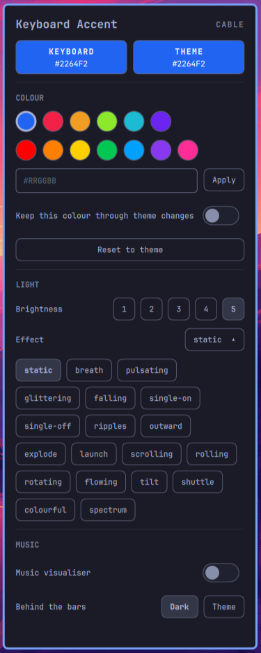

# AULA F75 Max for Omarchy

Makes the **AULA F75 Max** keyboard follow your [Omarchy](https://omarchy.org) theme, and controls everything else the vendor app does, on Linux, over the USB cable or the 2.4 GHz dongle.



**This only works with the AULA F75 Max** (wired `0c45:800a`, dongle `05ac:024f`). Other keyboards use different protocols.

## Features

- **Theme accent on the keys.** Every theme change, login and plug-in sets the keyboard to the theme's accent colour, chosen to read well on the LEDs, or to a colour you pin per theme. Over the cable the new colour sweeps across the keys as a wave (or a fade or a burst from the middle).
- **Bar widget.** Pick a colour (the theme's colours, bright presets or hex), brightness, any of the 19 lighting effects and their speed, and switch the music visualiser on and off.
- **Music visualiser.** Spectrum bars from your system sound across the keys, with a dark or theme-colour background.
- **`f75ctl`**, a command line for the rest: effects, per-key colours, key remaps and macros (with combos like `ctrl+c`), the LCD clock and images, and the battery level.
- **Costs nothing while idle.** No daemon and no polling: the keyboard's firmware keeps the colour, and a theme change takes about 0.05 s of CPU.

## Requirements

- An AULA F75 Max and Omarchy. Tested on Omarchy 4.0.6 (Arch, Hyprland); other versions are untested.
- `python3` 3.11+ and `jq` (widget).
- Optional: [`cava`](https://github.com/karlstav/cava) for the music visualiser (`sudo pacman -S cava`) and `python-pillow` for LCD images. `install.sh` lists the ones that are missing.
- `install.sh` needs sudo once, for a udev rule, a systemd one-shot unit and an `aula` group.

## Install

```bash
git clone https://github.com/beyondDREADFUL/aula-f75-max-omarchy
cd aula-f75-max-omarchy
./install.sh
```

`./install.sh` does the whole setup, including enabling the bar widget and restarting the shell the first time. `./install.sh --dry-run` prints the root commands and the Omarchy commands without running them. Log out and back in once so the `aula` group applies, then:

```bash
f75ctl theme apply
```

## The widget

A keyboard icon in the bar. Left-click opens the panel, right-click returns the keyboard to the theme colour, and the scroll wheel changes the brightness. The icon dims when no keyboard is connected; **Hide when disconnected** in Setup › Plugins removes it instead. Every choice applies at once; only the hex field waits for Apply.

| Section | What it does |
|---|---|
| Header | how the keyboard is connected, its battery over 2.4G |
| Keyboard / Theme | the keys' colour next to the theme's |
| Colour | the theme's colours, bright presets (the first is the firmware's own rainbow), a hex field, **Keep this colour** (pin it through theme changes), Reset to theme |
| Light | brightness 1-5 (slider), effect, speed for animated effects, and the transition between colours |
| Music | the visualiser switch (USB cable only) and the background behind the bars |

Commands to bind to keys (for example with `bindd` in `~/.config/hypr/bindings.conf`):

```bash
omarchy-shell beyond.aula-f75 toggle     # open or close the panel
omarchy-shell beyond.aula-f75 brighter   # or dimmer, or brightness 3
omarchy-shell beyond.aula-f75 music      # music on or off
omarchy-shell beyond.aula-f75 reset      # back to the theme colour
```

More in [docs/WIDGET.md](docs/WIDGET.md).

## The theme accent

On every theme change the keyboard takes the theme's accent. Saturated accents are kept; muted ones keep their hue with more saturation; grey and pale ones become a soft white. To choose the colour for a theme yourself, add it under `[theme_overrides]` in `~/.config/omarchy/aula-f75/config.toml`; [config.example.toml](config.example.toml) has the bundled themes and documents every setting, including showing the accent as an effect (`[lighting] effect = "breath"`) and syncing the LCD clock.

```bash
f75ctl theme status
f75ctl theme apply --color '#FF0000'          # until the next theme change
f75ctl theme apply --pin --color '#FF0000'    # keep it across theme changes
f75ctl theme unpin && f75ctl theme apply   # back to the theme colour
```

## f75ctl

```bash
f75ctl light breath -c 00ffff                 # any effect and colour; -b brightness, -s speed
f75ctl demo                                   # step through all 19 effects
f75ctl keycolors esc=ff0000 w=00ff00 --default 202020
f75ctl remap capslock=esc f1=a,b,c f2=ctrl+c  # remaps and macros, one layer per command
f75ctl reset-keymap
f75ctl gif cat.gif                            # LCD image or animation (needs pillow)
f75ctl music --background 202020              # spectrum bars; Ctrl+C returns to the theme
f75ctl battery                                # 2.4 GHz only
f75ctl settings --sleep 5 --debounce 3         # sleep after 1, 5 or 30 min (or never); debounce 1-5
f75ctl reset-keyboard --yes                   # clear remaps (factory-reset: everything); 2.4 GHz
```

`f75ctl --dry-run ...` prints the packets instead of sending them. Each `remap` or `macro` command replaces the whole layer, so put a layer's remaps and macros in one command.

## What works where

| Feature | USB cable | 2.4 GHz dongle |
|---|---|---|
| Theme accent, effects, brightness | yes | yes |
| Per-key colours | yes | yes |
| Remaps and macros, base layer | yes | yes |
| Fn layer | yes | no |
| LCD clock and images | yes | no |
| Music visualiser | yes | no |
| Battery level | no | yes |

Over the cable, a brightness set with the keyboard's own keys is read back and kept (while the keys show a static colour); the dongle has no read-back and reuses the last level set here. Other changes made with the Fn keys (colour, effect, speed) are not shown in the widget, and the next theme change replaces them: the keyboard doesn't report them, and only part of them can be read back (docs/HANDBOOK.md §5.3).

## Resources

| What | Cost |
|---|---|
| Everyday use | nothing runs; the keyboard's firmware keeps the colour |
| Theme change, login, plug-in | one apply: about 0.05 s of CPU, done in about 0.6 s |
| Music visualiser with cava | about 4 % of one CPU core while it runs |

## Troubleshooting

| Symptom | Check |
|---|---|
| The keyboard doesn't follow the theme | `tail ~/.local/state/omarchy/aula-f75/theme.log`; `result=deferred` means music or `f75ctl` held the keyboard |
| `keyboard not found` | `lsusb \| grep -iE '0c45:800a\|05ac:024f'`; the USB cable must carry data |
| `permission denied` | `id \| grep aula`; log out and back in after installing |

More in [docs/HANDBOOK.md](docs/HANDBOOK.md) §13.

## Upgrading

**From the `omarchy-keyboard-accent` names** (before 2026-10-24): run `./install.sh` again. It moves your config and state to `~/.config/omarchy/aula-f75` and `~/.local/state/omarchy/aula-f75`, keeps the widget in its place in the bar under its new id `beyond.aula-f75`, and removes the old commands, hooks, plugin and service. `omarchy-keyboard-accent ...` is now `f75ctl theme ...`; keybindings that call `omarchy-shell beyond.keyboard-accent ...` need the new id.

**From v1:** run `./install.sh` again: it installs its libraries to `~/.local/share/aula-f75`. Your `config.toml` keeps working; `underglow_correction`, `match_direct_zone` and `wireless_color_order` are ignored now. Colours from `[theme_overrides]` are unchanged; accents without an override can look slightly different, because v1 lowered green and blue to correct an underglow the keyboard doesn't have ([docs/HANDBOOK.md](docs/HANDBOOK.md) §14).

## Uninstall

```bash
./uninstall.sh            # removes everything but keeps your config and saved state
./uninstall.sh --purge    # also removes the config and state
./uninstall.sh --dry-run  # show what would be removed
```

The `aula` group is left in place (`sudo groupdel aula` removes it). Run `omarchy restart shell` afterwards to drop the bar widget.

## How it works

Theme changes and logins run an Omarchy hook, and plugging in the cable or dongle runs a one-shot systemd unit from udev; each starts one apply. All programs share one lock on the keyboard, so they never interleave packets. The protocol, how it was verified and the design are in [docs/HANDBOOK.md](docs/HANDBOOK.md).

| Path | Installs to | Purpose |
|---|---|---|
| `aula_f75/` | `~/.local/share/aula-f75` | Protocol library (Python standard library only) |
| `theme/` | `~/.local/share/aula-f75` | `f75ctl theme`: reads the theme accent and sets the keyboard |
| `bin/f75ctl-theme-queue` | `~/.local/bin` | Debounced dispatch so theme switching never blocks |
| `bin/f75ctl` | `~/.local/bin` | The command line, including `f75ctl theme` |
| `hooks/aula-f75.sh` | `~/.config/omarchy/hooks/{theme-set.d,post-boot.d}` | Runs the queue on theme change and at login |
| `system/` | `/etc/udev/rules.d`, `/etc/systemd/system` | Access to the keyboard and an apply on plug/unplug |
| `config.example.toml` | `~/.config/omarchy/aula-f75/config.toml` | Settings; never overwritten |
| `manifest.json`, `AulaF75.qml`, `bin/aula-f75` | `~/.config/omarchy/plugins/beyond.aula-f75` | The bar widget |

## Tests

```sh
python3 -m unittest discover tests
```

Covers the packet builders against bytes verified on the keyboard, the calibration model against read-back values, the colour choice and the widget's palette and effect settings. `f75ctl theme apply --verify` checks the keys on the hardware.

## License

MIT, see [LICENSE](LICENSE).
