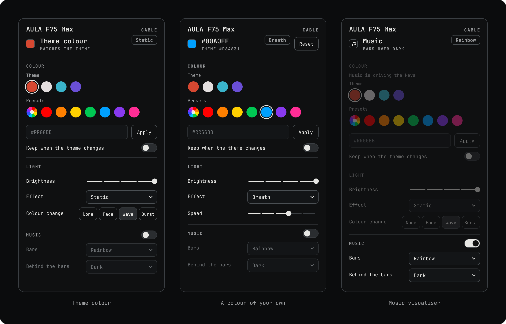

# AULA F75 Max for Omarchy

Your **AULA F75 Max** follows your [Omarchy](https://omarchy.org) theme, and everything the vendor app does works on Linux, over the USB cable or the 2.4 GHz dongle.



> **AULA F75 Max only** (cable `0c45:800a`, dongle `05ac:024f`). Other AULA keyboards, the plain F75 included, use different protocols.

## Features

- **The theme's colour on the keys.** Every theme change, login and plug-in sets the keys to the theme's accent, adjusted to look right on the LEDs, or to a colour you choose per theme. Over the cable the new colour sweeps across the keys.
- **A bar widget.** Colours (the theme's, presets, the firmware's rainbow, any hex), brightness, the 19 effects and their speed, and the music visualiser, from one panel.
- **Music visualiser.** Spectrum bars from your system sound, in the bar colour and background you pick.
- **`f75ctl`**, a command line for the rest: per-key colours, key remaps and macros, the LCD clock and images, sleep and debounce, resets and the battery level.
- **Nothing runs while idle.** No daemon and no polling: the keyboard keeps its colour, and a theme change costs about 0.05 s of CPU.

## Install

You need:
- an AULA F75 Max and Omarchy (tested on Omarchy 4.0.6; other versions are untested)
- `/usr/bin/python3` 3.11 or newer, and `jq` for the widget
- optionally [`cava`](https://github.com/karlstav/cava) for the music visualiser and `python-pillow` for LCD images (`install.sh` says which are missing)

```bash
git clone https://github.com/beyondDREADFUL/aula-f75-max-omarchy
cd aula-f75-max-omarchy
./install.sh
```

`install.sh` asks for sudo once, to add a udev rule, a systemd one-shot unit and an `aula` group. The first time, it also enables the bar widget and restarts the shell, if `omarchy` and `jq` are installed. `./install.sh --dry-run` prints every command without running any of them.

Log out and back in once so the `aula` group applies. The keyboard then follows your theme. To apply it right away:

```bash
f75ctl theme apply
```

**Updating:** `git pull` and run `./install.sh` again. Your config and state are kept.

**Uninstalling:** `./uninstall.sh` removes everything except your config and saved state; `--purge` removes those too, and `--dry-run` shows what it would do. The `aula` group stays (`sudo groupdel aula` removes it). Run `omarchy restart shell` afterwards to drop the widget.

## The widget

A keyboard icon in the bar: **left-click** opens the panel, **right-click** returns the keys to the theme colour, and **scrolling** changes the brightness. The icon dims when no keyboard is connected; **Hide when disconnected** in Setup › Plugins removes it instead.

| Part | What it does |
|---|---|
| Header | the connection; over 2.4G the battery, in a warning colour when low |
| Status line | what the keys show (the theme colour, a colour of yours, the rainbow or music) and the effect; **Reset** when the keys differ from the theme |
| Colour | the theme's colours and presets (the first is the firmware's rainbow, which works with any effect), a hex field, and **Keep when the theme changes** |
| Light | brightness, the effect, speed for animated effects, and how a new colour sweeps in over the cable |
| Music | the visualiser switch (USB cable only), the bar colour and what shows behind the bars; while music plays, Colour and Light are locked |

Every choice applies at once; only the hex field waits for Apply. Scrolling over a dropdown steps through its options.

To bind keys, for example with `bindd` in `~/.config/hypr/bindings.conf`:

```bash
omarchy-shell beyond.aula-f75 toggle     # open or close the panel
omarchy-shell beyond.aula-f75 brighter   # or dimmer, or brightness 3
omarchy-shell beyond.aula-f75 music      # music on or off
omarchy-shell beyond.aula-f75 reset      # back to the theme colour
```

More in [docs/WIDGET.md](docs/WIDGET.md).

## The theme colour

On every theme change the keys take the theme's accent. Saturated accents are used as they are, muted ones get more saturation, and grey or pale ones become a soft white. To choose the colour for a theme yourself, add it under `[theme_overrides]` in `~/.config/omarchy/aula-f75/config.toml`. [config.example.toml](config.example.toml) lists the bundled themes and every setting, such as showing the accent as an effect (`[lighting] effect = "breath"`) or syncing the LCD clock.

```bash
f75ctl theme status                           # the theme, its colour and the keyboard's state
f75ctl theme apply --color '#FF0000'          # a colour until the next theme change
f75ctl theme apply --pin --color '#FF0000'    # a colour that stays across theme changes
f75ctl theme reset                            # back to the theme colour
```

## Command line

```bash
# lighting
f75ctl light breath -c 00ffff                 # any effect and colour; -b brightness, -s speed
f75ctl demo                                   # step through all 19 effects
f75ctl keycolors esc=ff0000 w=00ff00 --default 202020

# keys
f75ctl remap capslock=esc f1=a,b,c f2=ctrl+c  # remaps and macros, one layer per command
f75ctl reset-keymap

# LCD and music
f75ctl gif cat.gif                            # LCD image or animation (needs pillow)
f75ctl music --background 202020              # spectrum bars; Ctrl+C returns to the theme

# keyboard
f75ctl settings --sleep 5 --debounce 3        # sleep after 1, 5 or 30 min (or never); debounce 1-5
f75ctl battery                                # 2.4 GHz only
f75ctl reset-keyboard --yes                   # clear the remaps (factory-reset: everything); 2.4 GHz
```

`f75ctl --dry-run ...` prints the packets instead of sending them. Each `remap` or `macro` command replaces the whole layer, so give a layer's remaps and macros in one command. `f75ctl keys` lists the key names.

### Cable or dongle

| Feature | USB cable | 2.4 GHz dongle |
|---|---|---|
| Theme colour, effects, brightness | yes | yes |
| Per-key colours | yes | yes |
| Remaps and macros, base layer | yes | yes |
| Fn layer | yes | no |
| LCD clock and images | yes | no |
| Music visualiser | yes | no |
| Sleep and debounce (`settings`) | yes | yes |
| Battery level, `reset-keyboard`, `factory-reset` | no | yes |

Changes made with the keyboard's own Fn keys (colour, effect, speed) don't show in the widget, and the next theme change replaces them: the keyboard doesn't report them. A brightness set with the Fn keys is read back over the cable while the keys show a static colour.

## Troubleshooting

| Symptom | Check |
|---|---|
| The keyboard doesn't follow the theme | `tail ~/.local/state/omarchy/aula-f75/theme.log`; `result=deferred` means music or `f75ctl` held the keyboard |
| The widget says "keyboard busy" | music or another `f75ctl` command is using the keyboard; stop it and try again |
| `keyboard not found` | `lsusb \| grep -iE '0c45:800a\|05ac:024f'`; the USB cable must carry data |
| `permission denied` | `id \| grep aula`; log out and back in after installing |

More in [docs/HANDBOOK.md](docs/HANDBOOK.md) §13.

## How it works

Theme changes and logins run an Omarchy hook; plugging in the cable or the dongle starts a one-shot systemd unit from udev. Each runs one apply, and every program takes the same lock on the keyboard, so they never interleave packets. The protocol, how each part was verified and the design are in [docs/HANDBOOK.md](docs/HANDBOOK.md).

| Path | Installs to | Purpose |
|---|---|---|
| `aula_f75/` | `~/.local/share/aula-f75` | The protocol library (Python standard library only) |
| `theme/` | `~/.local/share/aula-f75` | `f75ctl theme`: reads the theme and sets the keyboard |
| `bin/f75ctl` | `~/.local/bin` | The command line |
| `bin/f75ctl-theme-queue` | `~/.local/bin` | Debounced dispatch, so switching themes never waits on the keyboard |
| `hooks/aula-f75.sh` | `~/.config/omarchy/hooks/{theme-set.d,post-boot.d}` | Runs the queue on a theme change and at login |
| `system/` | `/etc/udev/rules.d`, `/etc/systemd/system` | Access to the keyboard, and an apply on plug and unplug |
| `config.example.toml` | `~/.config/omarchy/aula-f75/config.toml` | Settings; never overwritten |
| `manifest.json`, `AulaF75.qml`, `bin/aula-f75` | `~/.config/omarchy/plugins/beyond.aula-f75` | The bar widget |

**Resources:** nothing runs in everyday use. A theme change, login or plug-in costs about 0.05 s of CPU and is done in about 0.6 s. The music visualiser with cava uses about 4 % of one CPU core while it plays.

**Security:**
- The udev rule opens only the keyboard's command and LCD interfaces, to the `aula` group and the logged-in user. The dongle must also report its product name, because its USB id belongs to Apple.
- The systemd unit runs as you, sandboxed: read-only home except its state folder, hidraw devices only, no new privileges.
- The keyboard lock and state live in a private folder in your home.
- Anyone in the `aula` group can send commands to the keyboard, so keep the group to yourself.

**Tests:** `python3 -m unittest discover tests` covers the packet builders against bytes verified on the keyboard, the colour choice and calibration, the controller and the widget's helper. `f75ctl theme apply --verify` checks the keys on the hardware.

<details>
<summary>Upgrading from older versions</summary>

**From the `omarchy-keyboard-accent` names** (before 2026-10-24): run `./install.sh` again. It moves your config and state to `~/.config/omarchy/aula-f75` and `~/.local/state/omarchy/aula-f75`, keeps the widget in its place in the bar under its new id `beyond.aula-f75`, and removes the old commands, hooks, plugin and service. `omarchy-keyboard-accent ...` is now `f75ctl theme ...`; keybindings that call `omarchy-shell beyond.keyboard-accent ...` need the new id.

**From v1:** run `./install.sh` again; it installs its libraries to `~/.local/share/aula-f75`. Your `config.toml` keeps working; `underglow_correction`, `match_direct_zone` and `wireless_color_order` are ignored now. Colours from `[theme_overrides]` are unchanged; accents without an override can look slightly different, because v1 lowered green and blue to correct an underglow the keyboard doesn't have ([docs/HANDBOOK.md](docs/HANDBOOK.md) §14).

</details>

## License

MIT, see [LICENSE](LICENSE). The history of changes is in [CHANGELOG.md](CHANGELOG.md).
